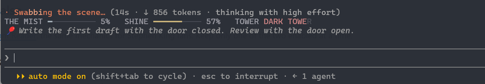

# Constant Reader

A Claude Code mod for Stephen King fans. It turns session stats into a small story above your prompt: the mist rises as context fills, your shine fades with the 5-hour limit, and the letters of the Dark Tower go dark as the weekly limit is used.



Fan theme. All lines are original, built on motifs from the books. Sounds are synthesized. Not affiliated with or endorsed by the author.

## Install

At the prompt of a Claude Code terminal session:

```
/plugin install constant-reader --marketplace I3rixon/claude-constant-reader
```

Answer `y` to add the marketplace, then press Enter to pick the user scope. The mod is active right away.

From a shell:

```
claude plugin install constant-reader --marketplace I3rixon/claude-constant-reader
```

In the desktop app, where `/plugin` does not run: click **+** next to the prompt box, then **Plugins**, **Add marketplace** with `I3rixon/claude-constant-reader`, then **Add plugin**.

To remove it later:

```
claude plugin uninstall constant-reader
```

## What it does

- **Stat bars above the prompt**
  - **THE MIST**: context fill. Turns thick at the threshold (default 30%) and shows one toast: time to `/compact` or hand off.
  - **SHINE**: what is left of the 5-hour limit.
  - **TOWER**: the weekly limit. The letters of `DARK TOWER` go dark as the limit is used.
  - Shine and Tower need a Claude subscription; with an API key they show `n/a`.
- **Spinner verbs**: "Following the red balloon", "Typing in the Overlook", ... Rotates about every 30 s.
- **Turn footer**: "Floated for 12s", "Buried for 1m 4s".
- **Tips**: one dev tip under the bars, a new one each turn.
- **Sounds** (soft): typewriter clicks and a bell when a turn ends, two soft notes when a permission is needed.
- **Break timer**: `/break 45m` shows a countdown above the prompt. When it ends, a window asks you to step away. Its button unlocks after 10 s.

## Commands

| Command | What it does |
|---|---|
| `/reader` | Show the current stats |
| `/reader on` / `/reader off` | Turn the theme on or off (kept across sessions) |
| `/reader tip` | Show a random tip |
| `/break 45m` | Start a break timer (`90s`, `45m`, `1h30m`, or a number of minutes) |
| `/break status` / `/break off` | Show or cancel the timer |

## Settings

Run `/plugin configure constant-reader@claude-constant-reader`, or open `/config`:

- `mistThreshold`: context fill (%) at which the mist turns thick. Default `30`.
- `sounds`: play sounds. Default `true`.

## Platform notes

- **Windows**: sounds play through PowerShell; the break popup is a small WinForms window.
- **macOS**: sounds play through `afplay`; at the end of a break you get a toast instead of a window.
- **Linux**: no sounds; break shows a toast.

## Files

- `hooks/register.tsx`: the hooks module
- `hooks/lines.ts`: spinner verbs, footer words and tips (edit these to make it yours)
- `sounds/*.wav`: synthesized sounds
- `scripts/break.ps1`: Windows break popup

## License

MIT. See [LICENSE](LICENSE).
